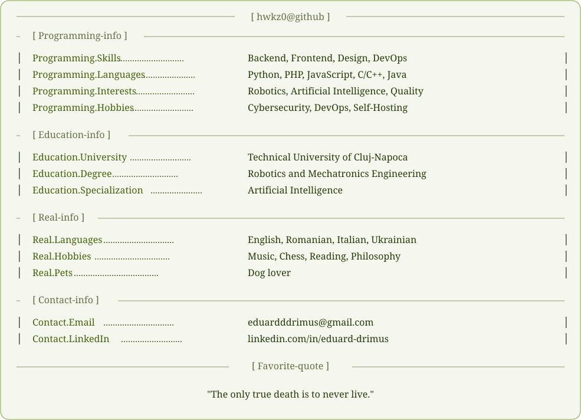

  

<!-- Easter should be somewhere around the corner -->

  <a href="./profile-dark-mode.svg">
    <picture>
      <source media="(prefers-color-scheme: dark)" srcset="./profile-dark-mode.svg" />
      
    </picture>
  </a>

   
  
  
    <a href="./profile-dark-mode.svg">Click here if SVG doesn't load.</a>
  

  

  <!-- Welp, you might have missed Easter... -->